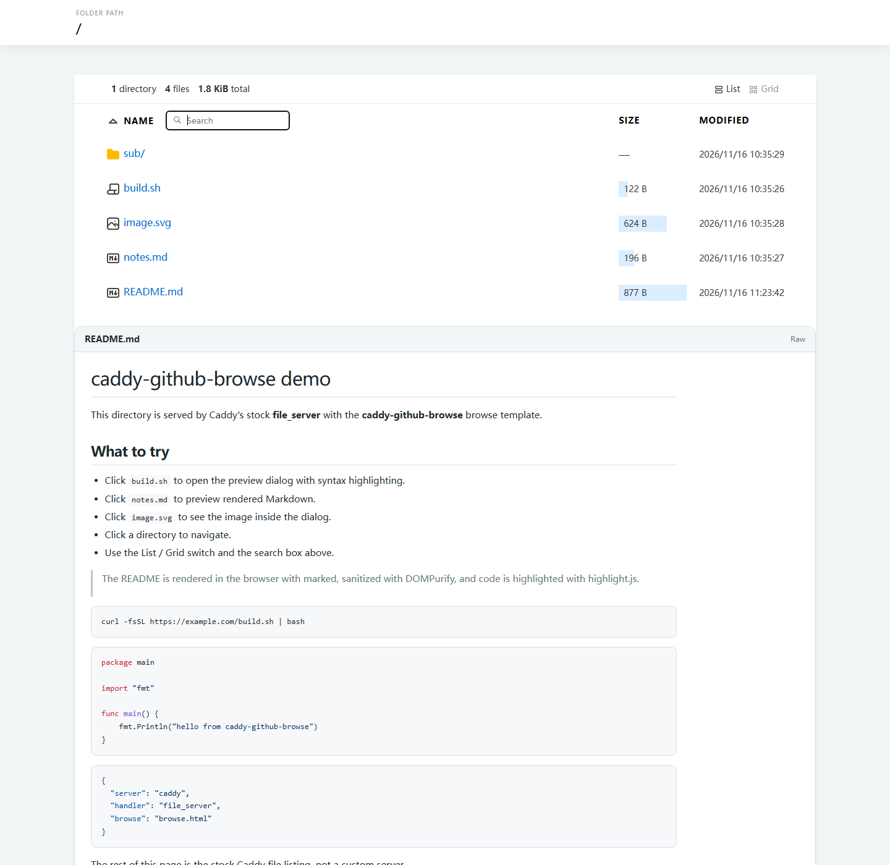
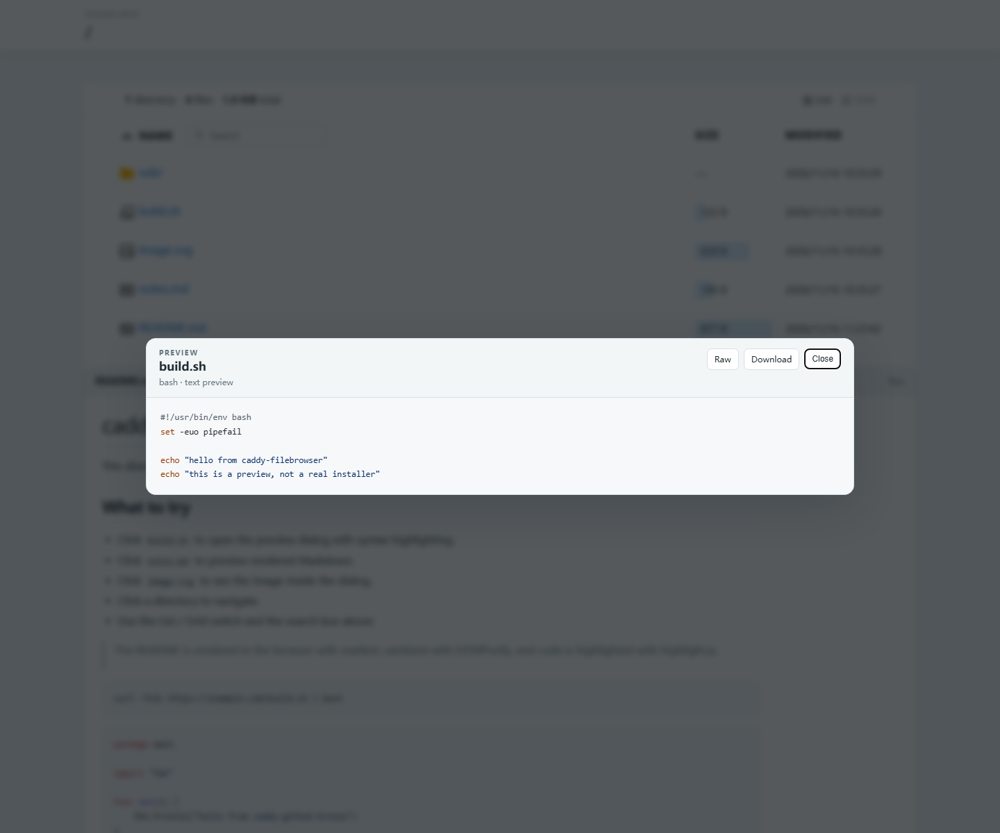

# caddy-github-browse

A single-file [Caddy](https://caddyserver.com/) `file_server` browse template with:

- GitHub-style README rendered below the directory listing
- Click-to-open preview dialog instead of navigating to the raw file
- Syntax highlighting for source files and README code blocks
- Markdown rendered/source switch in the dialog
- Images, SVG, PDF, audio and video previews
- The stock Caddy list/grid view, search, sorting, breadcrumbs and file counts
- Light and dark themes from the browser color scheme
- No plugin, no custom server, no build step at runtime

It runs on **Caddy's built-in `file_server`**. Only one HTML template is configured
through the native `browse` subdirective.

> v0.1.0 was an experimental standalone handler. v0.2.0 and later use the stock
> `file_server`; do not install the old module. There is no second server process.





## Live demo

http://103.116.247.139:8080/

The demo is served by Caddy's stock `file_server` on port 8080. There is no
secondary file server or plugin process.

## Install

1. Copy `browse.html` somewhere Caddy can read, for example `/etc/caddy/browse.html`.
2. Point `file_server` at it:

```caddyfile
:8080 {
    root * /usr/share/caddy
    file_server {
        browse /etc/caddy/browse.html
        hide .git .env
    }
    encode gzip
}
```

Reload Caddy:

```bash
sudo caddy validate --config /etc/caddy/Caddyfile --adapter caddyfile
sudo systemctl reload caddy
```

No xcaddy rebuild and no module installation are required. `file_server` remains
the handler that serves every file; the template only changes the directory page
and adds the browser-side preview.

## How it works

- Caddy's stock `file_server` renders the directory listing and serves raw files.
- The template adds a small amount of CSS/JS and two vendored browser libraries:
  - [marked](https://github.com/markedjs/marked) for Markdown
  - [highlight.js](https://highlightjs.org/) for syntax highlighting
  - [DOMPurify](https://github.com/cure53/DOMPurify) for sanitizing rendered Markdown
- On a directory page, the browser fetches `README.md`, `README.markdown`, `README`
  or `readme.md` (first match, up to 1 MiB) and renders it under the listing.
- Clicking a file fetches up to 1 MiB of text and opens the dialog. Images, PDF,
  audio and video are loaded directly from their normal URL.
- Ctrl/Cmd/Shift-click, middle-click and non-JavaScript users still get the normal
  raw file link from `file_server`.
- The template extends Caddy's stock Content-Security-Policy with
  `connect-src 'self'`, `media-src 'self'` and `frame-src 'self'` so previews work
  without allowing third-party scripts.

## Security

- This is a read-only browse template. Upload, edit and delete are not included.
- Markdown from a README is sanitized with DOMPurify before insertion.
- Raw HTML in README files is not trusted.
- External images are blocked by the Content-Security-Policy; relative images work.
- `file_server` still serves the original files; use Caddy authentication and
  filesystem permissions for private content:

```caddyfile
files.example.com {
    basic_auth {
        alice $2a$14$...hash...
    }
    root * /srv/files
    file_server {
        browse /etc/caddy/browse.html
    }
}
```

## Options

The template has no Caddy configuration options of its own. Use the stock
`file_server` options:

| Option | Meaning |
| --- | --- |
| `browse <file>` | Use this template for directory pages. |
| `hide <names...>` | Hide files/directories from the listing (for example `.git`). |
| `index <names...>` | Serve an index file instead of the browse page when present. |

The README candidates are fixed in `template/custom.js`; edit the `names` array and
rebuild if you need different names.

## Build / development

The committed `browse.html` is generated from:

- `template/browse.base.html` — Caddy's stock browse template (Apache-2.0)
- `template/custom.css` — README and dialog styles
- `template/custom.js` — README/modal logic
- `assets/highlight.min.js`, `assets/marked.min.js`, `assets/purify.min.js`

Rebuild after editing the sources:

```bash
python3 -I build-template.py
```

Then serve the demo locally:

```bash
caddy run --config testdata/Caddyfile --adapter caddyfile
# http://127.0.0.1:18080/
```

`testdata/Caddyfile` uses the stock `file_server` with
`browse ./browse.html`.

## Relationship to existing projects

Caddy v1's `filebrowser` plugin is archived and is not used here. The
`glowinthedark/caddy-file-server-browse-extension` project is a customized browse
template with a similar idea; this template is based on Caddy's current stock
`browse.html` and adds a README card, a preview dialog and CSP-safe Markdown.

## License

Apache-2.0. See [LICENSE](LICENSE) and [THIRD_PARTY_NOTICES.md](THIRD_PARTY_NOTICES.md).
The base template is derived from Caddy's stock `browse.html` (Apache-2.0).
